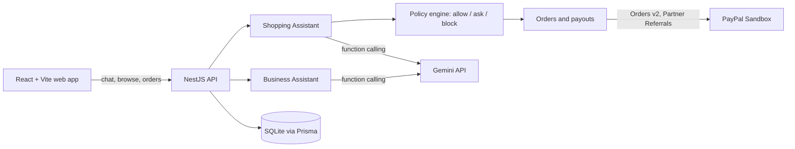

# College Business Corner

**A campus marketplace where students start small businesses and shop from each other, with an AI agent on both sides of every sale and PayPal moving the money.**

[Live demo]({{DEMO_URL}}) · [Demo video]({{VIDEO_URL}}) · Built for the [PayPal AI Hackathon](https://paypalaihackathon.devpost.com/)

---

## Why we built this

Many students finish a degree with one plan: find a job. The jobs are not keeping up. The International Labour Organization reports that [global youth unemployment rose to 12.4% in 2025, about 67 million people aged 15 to 24](https://www.ilo.org/resource/news/youth-unemployment-rises-young-people-face-harder-road-decent-work), and [that about one in five young people are outside employment, education or training](https://www.ilo.org/publications/flagship-reports/employment-and-social-trends-2026). It names slow growth, weak job creation and rapid technological change as reasons.

So what if the college years were also a place to practise being an entrepreneur? To try selling something small, win a first customer, and learn from it, before graduation instead of after?

College Business Corner is our attempt to make that first step easier:

- **A student who wants to start** (printing, haircuts, laundry, snacks, rides...) talks to a **Business Assistant**. It sets up the business and listings, guides the PayPal setup, shows what other students are searching for, and offers beginner tips and books. The student confirms every step.
- **A student who wants to buy** talks to a **Shopping Assistant**. It finds the right listings, shows them as cards, and prepares a checkout. The student can pick, or say "you decide, I'll just pay" and get the choice explained.
- **PayPal pays each seller directly.** One checkout can pay several student sellers at once, with a platform fee, and nothing is charged until the buyer approves in PayPal.

An AI agent on both ends makes it easy to start, and easy for fellow students to find and pay them.

## Try it in 60 seconds

1. Open the **[live demo]({{DEMO_URL}})** and click **Explore as a buyer**.
2. Tap an example prompt, or type something like *"I need 40 pages printed and a haircut, budget $25"*. You will see the listings as cards. Tap one to read about the business, or say *"choose for me, I'll just pay"*.
3. Approve the PayPal sandbox payment with any **sandbox Personal account** (create one free in the [PayPal Developer Dashboard](https://developer.paypal.com/dashboard/) under Testing tools, then Sandbox accounts). **No real money moves.**
4. Sign out, then click **Explore as a seller**. In **Assistant**, say *"I offer laundry at $15 per load"* and confirm the cards it prepares.

Sign-in has no password on purpose, see [below](#why-sign-in-has-no-password).

## What to look for

| | What it shows | Where |
|---|---|---|
| 1 | **Shopping Assistant.** Finds listings as cards, details in the chat, "you decide" with reasons for the pick | Home (buyer) |
| 2 | **Safety rules in plain code.** The AI can search and propose, but only the rules decide allow, ask or block. Personal spending limits (only ever stricter), and a private Safety log | My limits, Safety log |
| 3 | **One checkout, several sellers.** Each seller is paid directly, with a platform fee | PayPal approval, receipt, My orders |
| 4 | **Business Assistant.** Creates a business and listings, guides PayPal onboarding, suggests what to sell from anonymous search demand, offers a starter pack. Every action is a card the owner confirms | Assistant (seller) |
| 5 | **Seller dashboard.** Edit or hide listings, photos, and a Sales panel with fees and what you received | My business |

## How PayPal is used

We built a PayPal **Platform** (partner) integration against the sandbox:

- **Partner Referrals v2**: onboards a student seller so they can be paid directly.
- **Merchant Integrations**: checks whether a seller's account is ready to receive payments.
- **Orders v2** (create and capture): one order with a **purchase unit per seller**, each with its own payee and a `platform_fees` instruction, so every seller is paid and the platform keeps its fee.
- The **partner attribution** header on calls.

Code: `College-Business-Corner-Backend/src/paypal/` and `src/orders/`.

## How AI is used

Gemini (through `@google/genai` function calling) powers two assistants. The design rule is that **the AI proposes and the code decides**.

- **Shopping Assistant** tools: search listings and request a checkout. The request goes through a **policy engine written as ordinary code** (`src/policy/`): a hard cap, an "ask the buyer first" threshold, budget and price-change checks, and an audit log. The AI can never pay, approve or confirm. If the student hands the decision over, the assistant still only prepares the checkout, then explains what it picked and why.
- **Business Assistant** tools: read-only lookups plus "propose" tools that only create a card. Nothing is saved until the owner confirms it.
- **Nothing is invented on screen.** Listing cards come from the real search results, and the starter pack's books and links come from a checked list, not from the model's memory.
- **Demand insights** use anonymous keyword counts only. No user, IP or full sentence is stored, and nothing is shown until a word has been searched at least twice.

## Architecture



| Folder | What is in it |
|---|---|
| `College-Business-Corner-Backend/` | NestJS API: `src/agent` (both assistants), `src/policy`, `src/paypal`, `src/orders`, `src/businesses`, `src/insights` |
| `College-Business-Corner-Frontend/` | React + Vite app: `Chat.tsx`, `ListingCards.tsx`, `OwnerAssistant.tsx`, `Sell.tsx` |

## Run it yourself

The easiest way is the **[live demo]({{DEMO_URL}})**. To run it locally you need:

- **Node.js 22.12 or newer** (tested on 22.23 and 26.13)
- A [PayPal Developer](https://developer.paypal.com/) account with a **Platform app in the Sandbox**, a sandbox **Personal** (buyer) account, and sandbox **Business** (seller) accounts
- A free [Google AI Studio](https://aistudio.google.com/apikey) key for Gemini

**Backend** (API on `http://localhost:3000`, Swagger docs at `/docs`):

```bash
git clone {{REPO_URL}}
cd College-Business-Corner/College-Business-Corner-Backend
cp .env.example .env      # fill in the PayPal and Gemini values; each one is explained inside
npm install
npm run db:deploy         # creates the database and applies all migrations
npm run db:seed           # sample businesses and listings
npm run start:dev
```

**Frontend** (in a second terminal, on `http://localhost:5173`):

```bash
cd College-Business-Corner/College-Business-Corner-Frontend
cp .env.example .env      # VITE_API_URL=http://localhost:3000 is the default
npm install
npm run dev
```

> **Important: the sample sellers.** The seed script points its sample businesses at the author's own PayPal sandbox merchant accounts, and those can only be paid through the author's PayPal app. To check out locally, either set `SEED_PRINT_MERCHANT_ID` and `SEED_SALON_MERCHANT_ID` in `.env` to your own onboarded sandbox sellers before seeding, or sign in as a seller and use the Business Assistant to create a business and connect PayPal through the sandbox onboarding. The hosted demo is already set up.

If something goes wrong (ports in use, sign-in hanging, Node version errors), see **Troubleshooting** in `College-Business-Corner-Backend/README.md`.

## Why sign-in has no password

This project exists to show an **AI assistant** and **PayPal payments**. Sign-in is deliberately frictionless so that a judge or visitor reaches those features in one click: no registration, no email verification, no password to create or reset. Click **Explore as a buyer** or **Explore as a seller**, or type any email.

What still holds without a password: each account only sees **its own** data (enforced on the server from a signed session token and covered by automated tests), sessions expire after 7 days, and all payments run in PayPal's **sandbox**, so no real money moves.

The honest trade-off: anyone who knows an email can sign in as that account. That is fine for trying out sample data, so please do not use a real person's email or details. A real launch needs real sign-in (Google, a magic link, or passkeys). Full details are in the backend README.

## Privacy: who can see what

| Data | Who can read it |
|---|---|
| Businesses, listings, search | Everyone (it is a public marketplace) |
| A business's edits and sales | Only the owner account |
| Orders, spending limits, Safety log | Only that buyer |
| Receipt link | Anyone with the link (unguessable id). Shows the buyer's name only, never their email |

## Tests

```bash
cd College-Business-Corner-Backend
npm test            # unit tests: policy engine, pricing, agents, privacy rules
npm run test:e2e    # checks the app starts and its routes respond
```

## Built during the submission period

Built for the PayPal AI Hackathon submission period (Oct 1 to Nov 12, 2026). The first database migration is dated Oct 29, 2026.

## Tools and credits

- **PayPal**: Sandbox, Platform / Partner APIs (Partner Referrals, Merchant Integrations, Orders v2)
- **AI**: Google Gemini through `@google/genai`
- **Backend**: NestJS, Prisma, SQLite (`better-sqlite3`), TypeScript, Vitest
- **Frontend**: React, Vite, TypeScript
- **Photos**: [Pexels](https://www.pexels.com/license/), used under the Pexels License and not covered by the MIT license. See `College-Business-Corner-Frontend/ATTRIBUTION.md`.
- **Starter pack** links: Y Combinator Startup School, Paul Graham's essays, the ILO's Start and Improve Your Business programme, and Open Library.

## Limitations and next steps

- **Sandbox only.** No real money moves. Going live would need PayPal's production review for a Platform integration.
- **Passwordless sign-in** (see above) and a **single SQLite file** are right for trying it out, not for a real launch.
- **Free-tier AI limits.** On Google's free Gemini tier, heavy use can hit rate limits, and the assistant will retry or ask you to wait.
- **Not built yet:** shipping or delivery tracking, refunds and disputes, and reviews for sellers.
- **Next:** real sign-in, a seller reputation system, and campus-specific pickup and delivery options.

## License

MIT. See [LICENSE](LICENSE).
